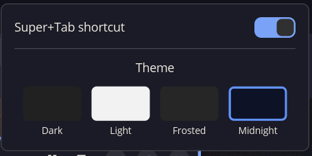

# cosmic-ext-app-switcher

A COSMIC window switcher with live thumbnail previews.  Alt+Tab or Super+Tab
opens a panel-sized grid of up to three rows of window previews instead of the
default vertical list.  The selected window's icon and title appear directly
under its preview, and the whole UI stays warm in a resident daemon so the next
switch is fast.

For how the daemon, preview capture, and UI fit together, see
[docs/architecture.md](docs/architecture.md).

> **AI-generated and unsupported:** This project is almost fully AI-generated
> code, produced with DeepSeek V4.1 Flash. It works for my setup, but I do not
> plan to provide support or maintenance. Use it at your own risk.

<table align="center">
  <tr>
    <td align="center"></td>
  </tr>
  <tr>
    <td align="center"><em>Panel applet — theme picker, scope, and shortcut toggle</em></td>
  </tr>
</table>

---

## Features

- Live window thumbnails in a balanced grid of up to 3 rows.
- Cached previews render immediately; missing previews stream in while the
  switcher is open.
- Resident daemon with a persistent Wayland backend and a background capture
  worker.
- MRU order: current window first, and repeated Alt+Tab toggles between the last
  two windows.
- Selected-window icon and title in a pill directly under the selected preview,
  limited to the preview width.
- Page counter and sliding pagination when there are more windows than fit.
- `--preview-count N` page size from 1 to 18; the panel keeps its 6x3 footprint
  while the visible cards grow.
- Themes: Dark, Light, Frosted, and Midnight.
- Panel applet for theme, scope, and shortcut control.
- App-icon fallback when window capture is unavailable.

## Install

Build from source with a system-linked Rust toolchain:

```bash
sudo apt install pkg-config libxkbcommon-dev libgbm-dev

curl --proto '=https' --tlsv1.2 -sSf https://sh.rustup.rs | sh -s -- -y
source "$HOME/.cargo/env"

make install
```

`make install`:

- builds the release binaries,
- installs the real binaries under `~/.local/bin/` with a `-bin` suffix,
- installs a small runtime wrapper that sets the system Wayland library path,
- installs the panel applet,
- registers the `WindowSwitcher` / `WindowSwitcherPrevious` shortcuts,
- installs an autostart entry that starts the daemon hidden at login.

Use `make quit` to stop the resident daemon and `make uninstall` to remove the
binaries, applet, shortcut, and autostart entry.

### Nix build dependencies

```bash
nix-shell -p pkg-config libxkbcommon wayland libgbm --run 'make build'
```

A binary built with Nix's glibc may not find the system
`libwayland-client.so.0` at runtime.  For a normal installed shortcut, build
with rustup/system Rust.  If you install a Nix-built binary with `make install`,
the wrapper under `~/.local/bin/cosmic-ext-app-switcher` adds the system library
path.

## Usage

| Shortcut | Action |
|---|---|
| Super+Tab / Alt+Tab | Open the switcher / cycle forward |
| Super+Shift+Tab / Alt+Shift+Tab | Cycle backward |
| Release modifier | Activate the selected window |
| Enter | Activate the selected window |
| Escape | Cancel and return to the original window |
| Click preview | Select |
| Release click | Activate |

The first invocation, or the autostart entry at login, starts the resident
daemon.  Later shortcut presses only ask the daemon to show or cycle.

### Daemon options

```bash
cosmic-ext-app-switcher --daemon           # start hidden
cosmic-ext-app-switcher --quit             # stop the daemon
cosmic-ext-app-switcher --no-previews      # use app icons instead of thumbnails
cosmic-ext-app-switcher --preview-count 6  # page size, 1..18
```

`--preview-count N` controls how many previews are shown at once.  The panel
keeps its full 6x3 footprint; with fewer cards the grid uses fewer rows and
columns and the cards become larger.  The visible page still slides through all
windows.

Because the switcher is resident, `--scope`, `--no-previews`, and
`--preview-count` are read when the daemon starts.  Restart it after changing
them:

```bash
make quit
# then press the shortcut once, or run:
~/.local/bin/cosmic-ext-app-switcher --daemon &
```

`make install PREVIEW_COUNT=6` writes the page size into the autostart entry.

Theme changes are applied on the next show.

### Scope

The panel applet can limit the list to the monitor you are working on.  The
`--scope` flag overrides the applet setting for one invocation:

```bash
cosmic-ext-app-switcher --scope all              # every window (default)
cosmic-ext-app-switcher --scope current-monitor  # only this monitor's windows
```

COSMIC routes both Alt+Tab and Super+Tab through the single `WindowSwitcher`
action, so they cannot have different scopes by themselves.  To give Alt+Tab
its own scope, add a custom binding in
`~/.config/cosmic/com.system76.CosmicSettings.Shortcuts/v1/custom`:

```ron
    (modifiers: [Alt], key: "Tab"): Spawn("/home/YOU/.local/bin/cosmic-ext-app-switcher --scope current-monitor"),
    (modifiers: [Alt, Shift], key: "Tab"): Spawn("/home/YOU/.local/bin/cosmic-ext-app-switcher --scope current-monitor --reverse"),
```

Add those inside the existing `{ }`, with your own home directory in the paths.
A custom binding overrides COSMIC's default for the same keys.  Super+Tab keeps
using the applet's setting.

The scope belongs to the switcher that is already open; cycling an open
switcher does not reopen it with a different scope.

## Panel applet

Add **App Switcher Settings** from the COSMIC panel's applet picker.  It
provides:

- **Super+Tab shortcut** toggle,
- **Theme** picker: Dark, Light, Frosted, Midnight,
- **Switch scope**: all workspaces or the current monitor.

## Enable / disable / status

```bash
make enable         # register as COSMIC's window switcher (live reload)
make disable        # remove and restore COSMIC's default switcher
make status         # show installed/enabled state
make check-compat   # verify the required Wayland globals
make quit           # stop the resident daemon
```

## How it works

COSMIC's compositor lets a shortcut point at any binary.  The first invocation
binds a Unix socket and becomes the resident daemon.  Later shortcut presses
connect to that socket, send `next`/`prev`, and exit.

The daemon keeps:

- a persistent Wayland backend with the window list, MRU state, and activation
  handles,
- a background capture worker with one preview session and buffer per window,
- a warm preview cache keyed by ext-toplevel identifier,
- a panel-sized layer surface and a libcosmic/wgpu renderer.

On show, cached previews are sent to the UI immediately; missing previews are
captured first.  On hide, the surface becomes transparent and click-through
again while the daemon keeps running.

See [docs/architecture.md](docs/architecture.md) for the full design.

### Wayland protocols

- `ext_foreign_toplevel_list_v1` — enumerate open windows
- `zcosmic_toplevel_info_v1` v2+ — window metadata and activation handles
- `zcosmic_toplevel_manager_v1` — activate a window
- `ext_foreign_toplevel_image_capture_source_manager_v1` — create a capture source
- `ext_image_copy_capture_v1` — capture window frames
- `linux-dmabuf` / `wl_shm` — preview pixel buffers
- `zwlr_layer_shell_v1` — panel-sized overlay surface

These interfaces are COSMIC-specific or privileged, and a COSMIC update could
remove or change them.  Run:

```bash
cosmic-ext-app-switcher --check-compat
```

or `make check-compat`.  Missing preview-only globals disable thumbnails and
fall back to app icons; a missing required global prevents the switcher from
starting and logs the reason.

## Project structure

```text
src/
  main.rs      # launcher/daemon entry point, supervisor, IPC socket
  events.rs    # backend/UI command and event types
  app.rs       # resident libcosmic application: surfaces, focus, selection
  ui.rs        # panel layout, preview grid, selected-window pill
  wayland.rs   # persistent backend: windows, activation, MRU, outputs
  capture.rs   # background preview capture (dmabuf with shm fallback)
  icons.rs     # app_id -> icon handle and desktop-entry labels
applet/        # panel applet (theme, scope, shortcut toggle)
config/        # shared theme/scope configuration types
scripts/       # COSMIC shortcut config helpers and runtime wrapper
docs/
  architecture.md
  screenshot-applet.png
```

## Requirements

- COSMIC desktop / cosmic-comp with the Wayland globals listed above.
- Rust with edition 2024 support (rustup recommended).
- `pkg-config`, `libxkbcommon-dev`, and `libgbm-dev`.

Run `cosmic-ext-app-switcher --check-compat` to verify the compositor support.

## Known limitations

- Previews are snapshots, not live video.
- Capture uses dmabuf when available and shared memory otherwise; frames are
  downscaled on the CPU.
- The grid shows up to 3 rows and paginates beyond that.
- The daemon keeps a libcosmic/wgpu process and one capture buffer per window
  resident; memory grows with the number and resolution of open windows.
- Flatpak is unsupported because cosmic-comp withholds the required privileged
  protocols from sandboxed clients.
- Server-side window decorations may be omitted from previews.

## Credits

This project is based on the original
[cosmic-ext-app-switcher](https://github.com/j0rdiun/cosmic-ext-app-switcher)
by [j0rdiun](https://github.com/j0rdiun).  The original project provided the
COSMIC app-switcher foundation, shortcut integration, and icon handling; this
version adds the resident daemon, thumbnail capture, and preview UI.

Project homepage: [github.com/42wim/cosmic-ext-app-switcher](https://github.com/42wim/cosmic-ext-app-switcher).

## License

GPL-3.0-only — see [LICENSE](LICENSE).
